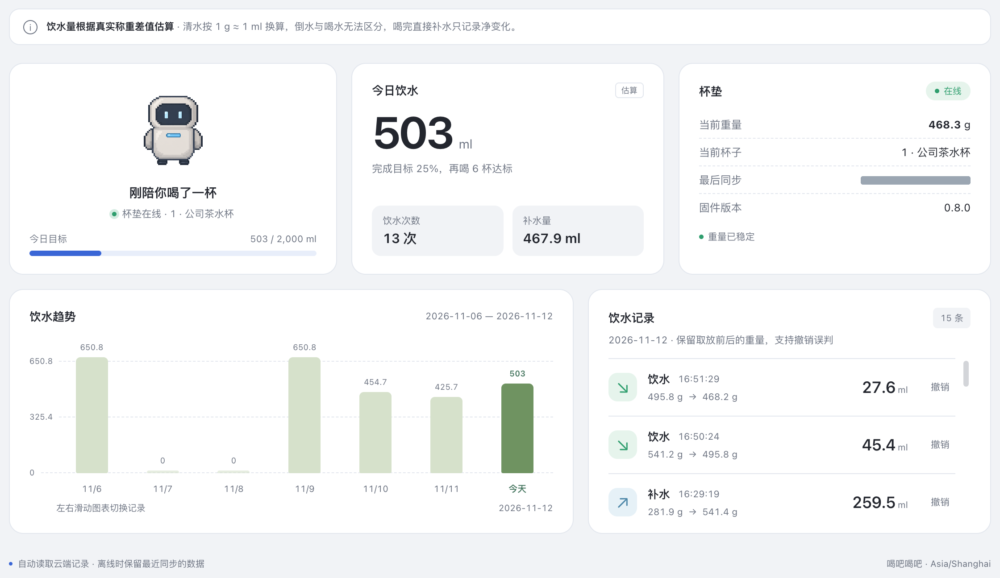

# 一起喝水吧：我做了一个无感记录每天饮水的杯垫

工作间隙喝了两口水，想要记录下喝了多少，一天喝了几次？如果每次都拿起手机或者点开软件手动记录，数据既不准确，姿势也一点都不优雅。

每天有开不完的会、做不完的工作，计划的每天八杯水总会被扔在脑后。

于是我做了**「一起喝水吧」**杯垫：给常用的杯子称一次空重，后续无论是向杯子里加水、喝水，不用自己亲自动手，每时每刻都有一个小助手在后台帮你进行记录。如果没有完成目标，你也可以设置弱提醒和强提醒进行通知。

初版原型与网页端记录页面如下：

## 现有功能

记录 **杯子放回去，这一口就记上了**
不用估毫升数，也不用拿手机打卡。上午用水杯，下午换茶杯，双击杯垫按钮切换，两只杯子各记各的。

提醒 **忙起来忘了喝水，让杯垫提醒我**
想轻轻提醒一下，可以用软件通知。忙起来顾不上看通知，也可以让桌上的杯垫亮屏、震动。

查看 **电脑和手机，哪里都能看**
坐在工位上，可以用网页、Mac 或 Windows 客户端看饮水记录。通勤路上用手机看，还能把今天的饮水量放在桌面卡片上更显眼。

**换个地方用：** 换了 Wi-Fi，可以给杯垫重新配网；要换账号，可以快速解绑再绑定。

## 后续：陪伴体系（构建 ing）

如果你恰好有一个志同道合的搭子，恰好还想和你一起分享记录每天饮水记录，那你们两个的杯垫就可以进行配对绑定～你可以类比理解为现实中的情侣空间，绑定后：

- 你可以选择是否和对方分享你喝的每一次记录。

- 可以约定一个每天饮水量、间隔时间，当没有完成目标时可以通过杯垫和软件提醒对方。

- 和你的搭子一起用每天的饮水喂养一只爱喝水的健康小猫／小狗，也可以是一盆每天都在生长的绿植。

## 如何使用

1. **通电、登录。** 给杯垫接上电源，打开手机或电脑访问网页，在网页上注册或登录账号。
2. **连接杯垫。** 杯垫未绑定的时候会自动打开绑定蓝牙，在网页上点击「添加杯垫」，页面会请求蓝牙权限去寻找杯垫，选中设备后，按系统提示与杯垫显示屏上的绑定码完成蓝牙配对。
3. **连上 Wi-Fi。** 杯垫绑定完成后，选择 2.4 GHz Wi-Fi，输入密码，等待杯垫连网并绑定到自己的账号。
4. **让杯垫记住空杯。** 在「杯垫设置 → 我的杯子」中添加杯子、起个名字。先把杯垫腾空，再开始称量；按提示放上空杯，静置至少 3 秒后保存。
5. **喝第一口。** 往杯里加水，放回杯垫，等重量稳定。接下来，拿起喝水、再放回去，记录就有了。

一次绑定，后续只需通电就能无感记录；后续想要换无线网、换账号，只需按照 web 页面说明操作即可，简单方便。

## 附录：饮水计算与部分客户端截图

### 饮水计算？

杯垫比较的是同一只杯子拿起前、重新放稳后的重量。杯子变轻了，因为不同饮品密度不同，目前只按清水估算少了多少水：**1 克水约等于 1 毫升**。后面计划每只杯子都能单独设置饮品密度，增加自由度。

### 安卓和mac客户端

**安卓｜看今天的进度**
喝了几次、补了多少水，都在手机上。

| Mac｜瞄一眼最近一口 | Mac｜选个桌面小伙伴 |
| :--- | :--- |
| 点开菜单栏，就能看上次几点喝、喝了多少。 | 挑一个陪伴形象，也可以在这里开关喝水提醒。 |
|  |  |
